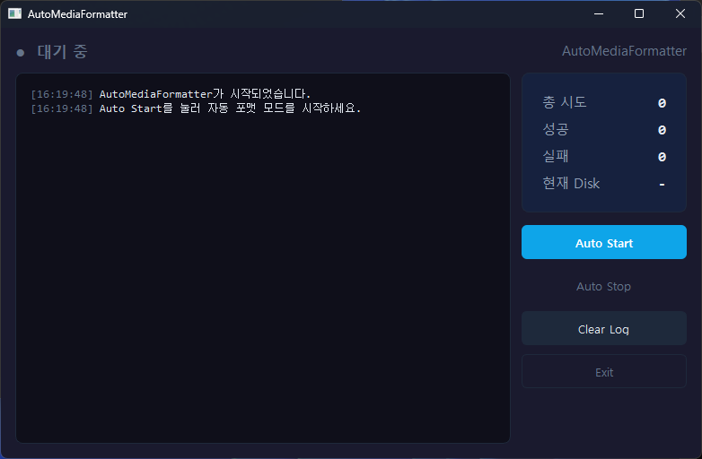

# AutoMediaFormatter

**Python 기반 메모리카드 볼륨 생성 및 포맷 자동화 프로그램**

메모리카드 연결 감지부터 디스크 검증, 파티션 생성 및 포맷까지의 반복 작업을 자동화하는 Windows GUI 애플리케이션입니다.

반복적인 저장장치 관리 작업을 줄이고, 작업 진행 상황과 결과를 직관적으로 확인할 수 있도록 개발했습니다.

## 1. 프로젝트 소개

| 항목 | 내용 |
|---|---|
| 프로젝트명 | AutoMediaFormatter |
| 개발 환경 | Windows 10 / 11 |
| 개발 언어 | Python |
| GUI 프레임워크 | PySide6 |
| 주요 목적 | 메모리카드 볼륨 생성 및 포맷 작업 자동화 |
| 실행 방식 | Windows GUI 애플리케이션 |

### 주요 기능

- **장치 연결 감지:** 일정 간격으로 디스크 정보를 조회하여 새로운 저장장치 연결을 감지합니다.
- **포맷 대상 검증:** 디스크 번호, 미디어 유형, 파티션 정보 등을 확인하여 작업 가능 여부를 판단합니다.
- **볼륨 생성 및 포맷:** Windows DiskPart를 이용해 파티션을 생성하고 exFAT 파일 시스템으로 포맷합니다.
- **실시간 작업 상태 표시:** 검증, 포맷 준비, 포맷 진행, 완료 및 실패 상태를 GUI에 표시합니다.
- **작업 통계 관리:** 전체 작업 횟수와 성공 및 실패 횟수를 집계합니다.
- **로그 관리:** 작업 진행 상황과 오류 메시지를 기록하고 GUI에서 확인할 수 있습니다.

- ## 실행 화면

프로그램의 메인 화면입니다.



## 2. 시스템 구성 및 동작 흐름

```text
[메모리카드 연결]
        |
        v
[DiskWatcher]
디스크 연결 상태 감지
        |
        v
[DiskInfo]
PowerShell을 통한 디스크 정보 조회
        |
        v
[DiskValidator]
포맷 대상 조건 검증
        |
        v
[Formatter]
포맷 작업 흐름 관리
        |
        v
[DiskPart]
파티션 생성 및 exFAT 포맷
        |
        v
[작업 결과 반환]
        |
        v
[PySide6 GUI]
상태 표시 및 작업 통계 갱신
```

## 3. 기술 스택

| 구분 | 기술 | 활용 목적 |
|---|---|---|
| Language | Python | 애플리케이션 로직 구현 |
| GUI | PySide6 | 데스크톱 사용자 인터페이스 |
| Disk Management | Windows DiskPart | 디스크 및 파티션 관리 |
| System Information | PowerShell, WMI/CIM | 디스크 정보 조회 |
| Image Processing | Pillow | 애플리케이션 아이콘 생성 |
| Packaging | PyInstaller | Windows 실행 파일 빌드 |
| Testing | Python | 주요 기능 및 예외 상황 검증 |

## 4. 프로젝트 구조

```text
AutoMediaFormatter/
│
├── app.py                  # 프로그램 진입점 및 실행 관리
├── build.py                # 실행 파일 빌드 스크립트
├── build.spec              # PyInstaller 빌드 설정
├── create_icon.py          # 애플리케이션 아이콘 생성
├── requirements.txt        # 외부 패키지 목록
├── test_diskpart.py        # DiskPart 관련 테스트
│
├── core/
│   ├── disk_info.py        # 디스크 정보 조회
│   ├── disk_watcher.py     # 저장장치 연결 감지
│   ├── diskpart.py         # DiskPart 명령 실행
│   ├── formatter.py        # 포맷 작업 관리
│   ├── validator.py        # 포맷 대상 검증
│   └── __init__.py
│
├── ui/
│   ├── main_window.py      # PySide6 GUI 구현
│   └── __init__.py
│
└── resources/
    ├── icon.ico
    └── icon.png
```

## 5. 주요 구현 내용

### ① 디스크 정보 조회 및 연결 감지

- PowerShell의 `Get-CimInstance`를 활용하여 시스템에 연결된 디스크 정보를 조회합니다.
- 디스크 번호, 모델명, 미디어 유형, 용량 및 파티션 정보를 수집합니다.
- QThread 기반의 백그라운드 감시를 통해 일정 간격으로 저장장치 연결 상태를 확인합니다.

### ② 포맷 대상 검증

- 시스템 디스크로 지정된 Disk 0 제외
- 허용된 미디어 유형 확인
- 기존 파티션 정보 확인
- 이미 포맷 작업이 진행 중인 디스크 확인

검증 로직을 별도 모듈로 분리하여 포맷 실행 전에 대상 디스크의 조건을 확인하도록 구성했습니다.

### ③ DiskPart 기반 포맷 자동화

Windows 기본 디스크 관리 도구인 DiskPart를 활용합니다.

주요 실행 명령은 다음과 같습니다.

```text
Select Disk [디스크 번호]
Clean
Create Partition Primary
Format FS=exFAT Label=[볼륨 이름] QUICK
Assign Letter=[드라이브 문자]
Exit
```

DiskPart 명령을 스크립트 파일로 생성하고 관리자 권한으로 실행하는 구조입니다.

### ④ GUI 및 작업 상태 관리

- PySide6를 이용한 데스크톱 GUI 구성
- Signal/Slot을 활용한 스레드 간 상태 전달
- 작업 단계별 실시간 상태 표시
- 성공 및 실패 통계 관리
- 로그 메시지의 시간 및 상태별 색상 구분

## 6. 개발 기여 및 문제 해결

프로젝트 개발 과정에서 다음 업무를 직접 수행했습니다.

- 자동화 대상 작업 및 기능 요구사항 기획
- 기능별 모듈 구성과 프로그램 동작 흐름 설계
- 기능 실행 및 테스트를 통한 오류 재현
- 테스트 결과를 바탕으로 문제 원인과 수정 방향 검토
- GUI 상태 표시와 작업 결과 확인
- 코드 실행 및 수정 과정을 통한 기능 개선

AI 도구를 개발 보조 수단으로 활용했으며, 생성된 코드의 실행 결과를 확인하고 테스트 및 수정 방향을 검토하는 방식으로 개발을 진행했습니다.

## 7. 실행 방법

### 개발 환경

- Windows 10 / 11
- Python 3.11 이상 권장
- 관리자 권한

### 패키지 설치

```bash
pip install -r requirements.txt
```

### 프로그램 실행

관리자 권한으로 터미널을 실행한 후 다음 명령어를 입력합니다.

```bash
python app.py
```

프로그램 실행 후 `Auto Start` 버튼을 누르면 저장장치 감시가 시작됩니다.

## 8. 실행 파일 빌드

PyInstaller를 이용하여 Windows 실행 파일을 생성할 수 있습니다.

```bash
python build.py
```

빌드 완료 후 다음 경로에 실행 파일이 생성됩니다.

```text
dist/AutoMediaFormatter.exe
```

실행 파일은 관리자 권한 승인을 요청하도록 설정되어 있습니다.

## 9. 테스트

테스트 스크립트를 통해 DiskPart 관련 주요 내부 기능을 검증할 수 있습니다.

```bash
python test_diskpart.py
```

현재 테스트 범위:

- 임시 스크립트 파일 생성 및 삭제
- DiskPart 스크립트 내용 확인
- 디스크 0 차단 확인
- 오류 메시지 감지
- 관리자 권한 확인

해당 테스트는 실제 DiskPart 포맷 명령을 실행하지 않습니다.

## 10. 주의사항 및 개선 과제

이 프로그램은 디스크의 파티션 정보를 삭제하고 새 파티션을 생성하는 작업을 수행합니다.

- `Clean` 명령 실행 시 선택한 디스크의 파티션 정보가 삭제됩니다.
- 포맷 대상에 중요한 데이터가 없는지 반드시 확인해야 합니다.
- 관리자 권한이 필요합니다.
- 실제 사용 전 테스트용 저장장치로 충분히 검증해야 합니다.

**향후 개선 과제**

- 시스템 및 부팅 디스크 식별을 통한 디스크 보호 강화
- 디스크 식별 정보와 상태 재검증
- 포맷 완료 후 실제 볼륨 생성 여부 확인
- 예외 상황 및 중복 작업 방지 강화
- 테스트 범위 확대

## 11. 개발 목적 및 기대 효과

반복적으로 수행하는 메모리카드 볼륨 생성 및 포맷 작업을 자동화하여 작업 절차를 단순화하고, GUI를 통해 작업 상태와 결과를 쉽게 확인할 수 있도록 하는 것이 프로젝트의 목적입니다.

단순한 명령어 실행을 넘어 디스크 정보 조회, 검증, 작업 제어, GUI 상태 관리 기능을 모듈별로 분리하여 유지보수와 기능 확장이 가능한 구조를 지향했습니다.
